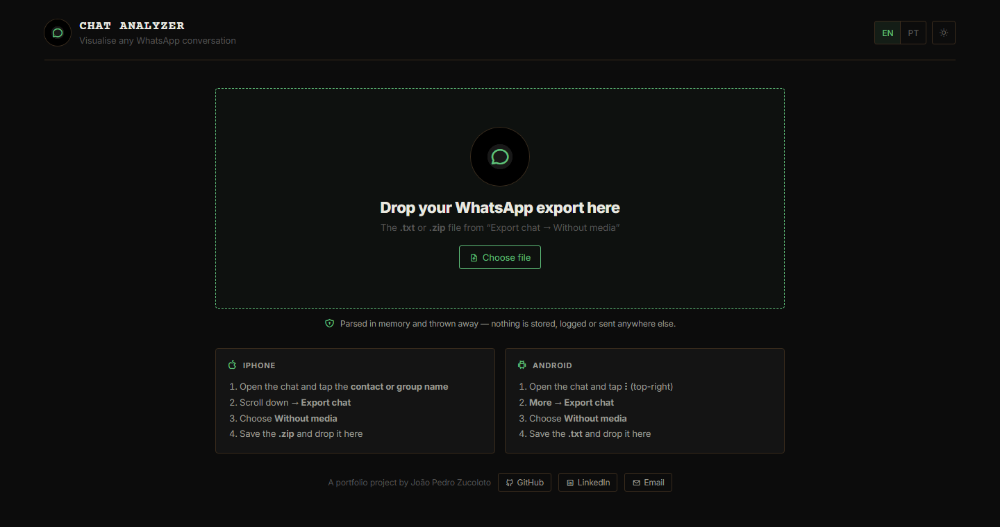

# 💬 Chat Analyzer

Drop in a WhatsApp chat export and see who talks the most, when, and how: activity, people, words,
and a shareable "Wrapped" card.

**[Live demo →](https://whatsappparser-production.up.railway.app/)** · English and Portuguese



## Privacy first

The export is parsed **in memory and thrown away**: there's no database, no volume and nothing in the logs.
The server only turns the text into compact rows. Every chart is computed in the browser.
The analytics (Umami, no cookies) record the shape of a chat in rounded ranges, never names, words or file names.

## Features

- **Overview, People, Activity and Messages views**, filtered by a date range (presets, a slider or exact dates).
- **Roster:** merge or rename people, for example someone who changed their number.
- **Wrapped:** a story-sized card of the period, drawn on a canvas, so the preview and the downloaded PNG are the same pixels. It can hide names.
- **Export** the messages as `.xlsx` or `.csv`.
- **Reads both iPhone and Android exports** (`.txt` or `.zip`) in English and Portuguese: date formats, 12/24-hour clocks, media and deleted-message markers.

## How it's built

| | |
|---|---|
| Backend | Python and Flask. The parser (`parse.py`) uses only the standard library. |
| Frontend | Vanilla JavaScript modules, one per view; i18n in `static/i18n.js` |
| Hosting | Railway (gunicorn), Docker image included |
| Tests | pytest for the parser and the API, plus Node tests for the JavaScript modules |

Some details:

- **Timestamps are kept as the chat's wall-clock time,** so no timezone ever moves a message to another day.
- **Zip uploads are size-checked** before and while they are decompressed. A zip's declared size can be faked, so both checks matter.
- **A synthetic chat generator** (`tools/gen_chat.py`) is used for testing at scale, so real conversations never enter the repo.

## Run locally

```bash
pip install -r requirements-dev.txt
python app.py                                 # http://localhost:5001
python -m pytest
python tools/gen_chat.py chats/pair.txt       # make a fake chat to try it with
```

Deployment and the list of analytics events are documented in Portuguese in [docs/operations.pt-BR.md](docs/operations.pt-BR.md).

## History

- **2022:** the first version, [Whats_App_Chat_To_Data](https://github.com/PepeZuco/Whats_App_Chat_To_Data) (archived), was a Python script that turned an export into an Excel file and charts.
- **2023–24:** this repo began as a Streamlit app.
- **September 2026:** rebuilt as the Flask and JavaScript app you see now.

---

Made by [João Pedro Longo Zucoloto](https://www.linkedin.com/in/jo%C3%A3o-pedro-longo-zucoloto-169638182/).
